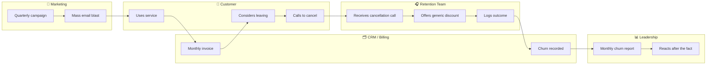
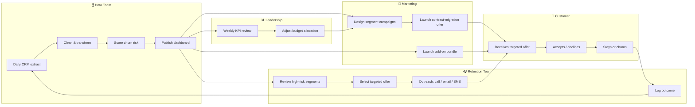

# Process Maps — Customer Churn Analysis and Retention Strategy

Two views of the retention process: the **AS-IS** state (how churn is handled today) and the
**TO-BE** state (how it will work once the analysis and dashboard are in place).

---

## AS-IS — Reactive retention

**Pain points**
- Retention is triggered only when the customer calls to cancel — too late.
- Offers are generic (flat discount) and not segment-specific.
- Marketing campaigns are mass-market, not targeted at high-risk segments.
- Leadership sees churn only after it has happened.

---

## TO-BE — Proactive, data-driven retention

**Improvements**
- Churn risk is scored **before** the customer calls to cancel.
- Offers are **segment-specific** (contract migration, add-on bundle, payment migration).
- Marketing campaigns are **targeted** at the top revenue-at-risk segments.
- Leadership reviews KPIs **weekly** and reallocates budget based on the dashboard.

---

## Gap analysis

| # | Gap (AS-IS) | Impact | TO-BE action | Owner |
|---|---|---|---|---|
| 1 | Retention triggered only on cancellation call | High — lost revenue | Score churn risk daily and trigger proactive outreach | Data Team + Retention |
| 2 | Generic discount offers | Medium — margin erosion | Segment-specific offers (contract, add-on, payment) | Retention Manager |
| 3 | Mass-market marketing | Medium — low ROI | Targeted campaigns on top revenue-at-risk segments | Marketing Director |
| 4 | Monthly, lagging churn reporting | High — slow reaction | Weekly dashboard review with KPI cards | Leadership |
| 5 | No visibility on add-on impact | Medium — missed upsell | Track churn by Tech Support / Online Security adoption | Product Managers |
| 6 | No feedback loop from outcomes | Medium — no learning | Log every outreach outcome and feed back into the model | Data Team |
